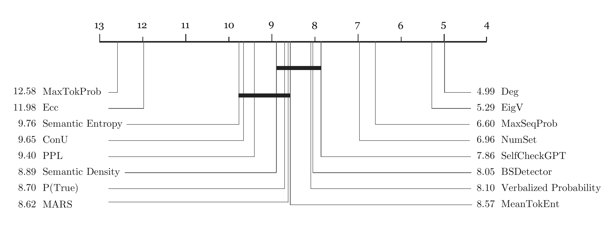
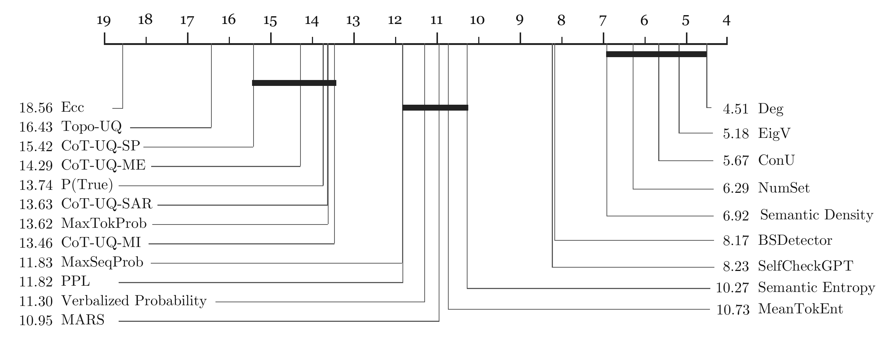

# LLM-UQ-Survey

Code for **The Origins of Stochasticity: Comprehensive Investigations on Uncertainty Quantification for Large Language Models**.

Xiang-Jun Ou, Shuang Liang, Xin-Yu Hu, Rong-Hao Huang, Jing Wang, and Shao-Qun Zhang · [Paper](https://arxiv.org/abs/2606.22792)

This repository implements the survey's evaluation pipeline for 21 uncertainty quantification methods across Qwen3, Llama 3.2 and DeepSeek-V3 model families, TriviaQA, GSM8K and HumanEval, and answer-only and reasoning-augmented generation. Supported combinations are listed in `registry.json`.

<p align="center">
  <br>
  <em>Overall evaluation ranking of the investigated LLM UQ methods in the answer-only generation setting.</em>
</p>

<p align="center">
  <br>
  <em>Overall evaluation ranking of the investigated LLM UQ methods in the reasoning-augmented generation setting.</em>
</p>

## Getting Started

```bash
git clone https://github.com/zhangsq-nju/LLM-UQ-Survey.git
cd LLM-UQ-Survey
conda create -n llm-uq-survey python=3.11
conda activate llm-uq-survey
pip install -r requirements.txt
```

Install a PyTorch build suitable for your CUDA installation. A GPU is recommended for local generation and model-based scoring. Run commands from the repository root. The upstream LM-Polygraph and SelfCheckGPT revisions are pinned in `requirements.txt`.

### Models

Provide a local checkpoint or Hugging Face model ID through `--model-path`. For DeepSeek, use the API model ID, set `DEEPSEEK_API_KEY` in your environment, and select `--setting answer_only`.

### Dataset Preparation

Prepare all three benchmarks using the upstream `3-shot` configuration and `test` split:

```bash
python -m data_generation.prepare --output-dir data
```

| Benchmark | Hugging Face dataset | Local input |
| --- | --- | --- |
| GSM8K | [graphUQ-ls-hxy/gsm8k_stop_strings](https://huggingface.co/datasets/graphUQ-ls-hxy/gsm8k_stop_strings) | `data/gsm8k.jsonl` |
| TriviaQA | [graphUQ-ls-hxy/trivia_stop_strings](https://huggingface.co/datasets/graphUQ-ls-hxy/trivia_stop_strings) | `data/triviaqa.jsonl` |
| HumanEval | [graphUQ-ls-hxy/humaneval_stop_strings](https://huggingface.co/datasets/graphUQ-ls-hxy/humaneval_stop_strings) | `data/humaneval.jsonl` |

## Running Experiments

Generate answers and compute MaxSeqProb uncertainty scores on GSM8K:

```bash
python run_uq.py --method max_seq_prob --family qwen --model-path Qwen/Qwen3-4B --dataset gsm8k --input-file data/gsm8k.jsonl --output-file outputs/max_seq_prob.jsonl --device cuda
```

Evaluate the uncertainty scores and save the metrics:

```bash
python -m metric_evaluation.evaluate --method lm_polygraph_max_seq_prob --input-file outputs/max_seq_prob.jsonl --output-file outputs/max_seq_prob.csv
```

## Important Parameters

| Parameter | Meaning |
| --- | --- |
| `--method` | UQ method; use `--list` for supported routes. |
| `--family` | `qwen`, `llama` or `deepseek`. |
| `--model-path` | Local checkpoint, Hugging Face ID or API model ID. |
| `--dataset` | `gsm8k`, `triviaqa` or `humaneval`. |
| `--setting` | `answer_only` (default) or `reasoning_augmented`. |
| `--input-file`, `--output-file` | Input and output paths; the input schema depends on the flow. |
| `--correct-file` | External correctness labels, including native HumanEval labels. |
| `--nli-model` | NLI or embedding checkpoint for compatible native backends. |
| `--device` | `cpu` or `cuda` for scoring. |
| `--overwrite` | Explicitly replace an existing output. |
| `--` | Pass backend-specific options after the public CLI options. |

`data_generation.generate` defaults to ten stochastic samples in addition to a greedy answer. Its sampling settings can be changed with `--num-samples`, `--temperature`, `--top-p` and `--max-new-tokens`. See `python -m data_generation.generate --help` for the full generation options.

## Outputs

The example writes:

```text
outputs/
  max_seq_prob.jsonl              # Generated answers, correctness labels and uncertainty scores
  max_seq_prob.csv                # Seven evaluation metrics
  max_seq_prob.evaluation.json    # Evaluation settings and input coverage
```

Higher is better for AUROC, AUPRC and AUARC; lower is better for AURC, ECE, MCE and Brier. Evaluation defaults to 200 bootstrap samples. CSV `mean` and `std` use raw metric units; the display column multiplies all metrics except Brier by 100. Use matching calibration and coverage settings when comparing methods.

## Citation

If you find this work helpful, please cite it as follows:

```bibtex
@article{ou2026origins,
  author  = {Xiang-Jun Ou and Shuang Liang and Xin-Yu Hu and
             Rong-Hao Huang and Jing Wang and Shao-Qun Zhang},
  title   = {The Origins of Stochasticity: Comprehensive Investigations on
             Uncertainty Quantification for Large Language Models},
  journal = {arXiv preprint arXiv:2606.22792},
  year    = {2026}
}
```
